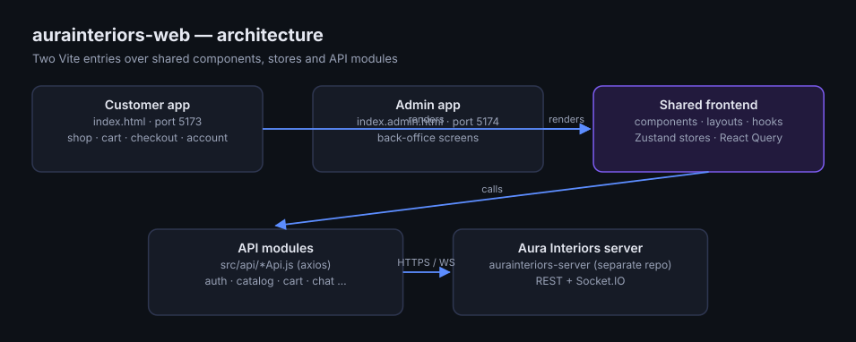
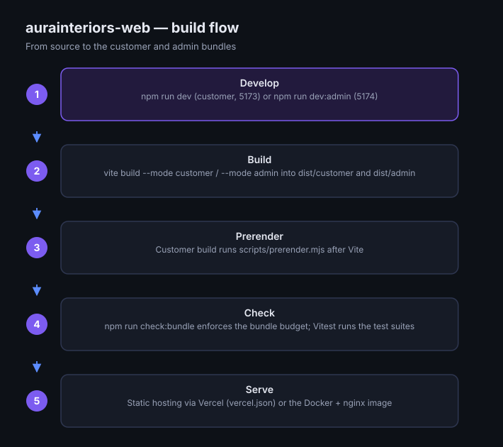

<div align="center">

<h1>aurainteriors-web</h1>

**Customer storefront and admin console for Aura Interiors.**

A React and Vite frontend with two entry points — a customer shop and an admin app — backed by the Aura Interiors API.

   

[Quick start](#quick-start) · [How it works](#how-it-works) · [Features](#features)

<code>npm install && npm run dev</code>

</div>


## Overview

This repository is the frontend for Aura Interiors, an interiors e-commerce product. One codebase builds **two apps**: the customer storefront (`index.html`, port 5173) and the admin console (`index.admin.html`, port 5174), selected by Vite mode (`--mode customer` / `--mode admin`).

Shoppers browse the catalog, manage a cart, check out and track their account; staff use the admin entry for back-office screens. The app also includes an AR preview built on Three.js and the `capacitor-arcore` package (vendored under `vendor/`), a chat client over Socket.IO, and a prerender step for the customer build. All data comes from the separate [aurainteriors-server](https://github.com/ShahiCrafts/aurainteriors-server) API.

## Features

- **Two entry points** — customer storefront and admin console from one codebase (`src/main.jsx` / `src/main.admin.jsx`)
- **Shop and checkout** — catalog pages, cart and checkout flows (`src/pages/shop`, `src/pages/checkout`)
- **Customer accounts** — auth and customer pages (`src/pages/auth`, `src/pages/customer`)
- **AR preview** — view products in augmented reality (`src/components/ar`, Three.js, `capacitor-arcore`)
- **Live chat client** — Socket.IO chat components (`src/components/chat`)
- **Typed data layer** — per-resource API modules in `src/api/`, React Query for server state, Zustand stores in `src/store/`
- **Forms with validation** — React Hook Form with Yup resolvers
- **Tested and budgeted** — Vitest suites under `tests/`, plus a bundle-budget check script

## How it works

Both entries share the same component, store and API layers. API modules in `src/api/` call the backend at `VITE_API_BASE_URL`; React Query caches server state while Zustand holds client state; the customer build is prerendered after `vite build`.



[Open the full-size figure](docs/assets/architecture.svg)

How the two builds are produced and served:



[Open the full-size figure](docs/assets/workflow.svg)

## Tech stack

| Area | Technology | Notes |
| --- | --- | --- |
| Framework | React 19 + React Router | Two entry points, customer and admin |
| Build | Vite 7 | Mode-based builds; prerender script |
| Styling | Tailwind CSS 4 | Via `@tailwindcss/vite` |
| State | Zustand, TanStack React Query | Client stores and server-state caching |
| HTTP / realtime | Axios, socket.io-client | REST API modules and chat |
| 3D / AR | Three.js, capacitor-arcore | Product AR preview; package vendored in `vendor/` |
| Forms | React Hook Form + Yup | Validated forms |
| Tests | Vitest, Testing Library, jsdom | Suites under `tests/` |

## Project structure

```text
aurainteriors-web/
├── index.html            Customer entry
├── index.admin.html      Admin entry
├── src/
│   ├── main.jsx          Customer bootstrap
│   ├── main.admin.jsx    Admin bootstrap
│   ├── App.jsx / AdminApp.jsx
│   ├── api/              Per-resource API modules
│   ├── components/       admin, ar, auth, cart, chat, checkout, shop, ui …
│   ├── pages/            shop, checkout, customer, auth, admin, info
│   ├── store/            Zustand stores
│   ├── hooks/  layouts/  lib/  seo/  styles/  utils/
├── tests/                Vitest suites
├── scripts/              Prerender and bundle-budget checks
├── vendor/               capacitor-arcore package tarball
├── Dockerfile            Node 20 build served by nginx
├── nginx.conf
└── vercel.json           SPA rewrites and asset caching
```

## Quick start

### Prerequisites

- Node.js 20 (the Dockerfile builds on `node:20-alpine`)
- The [aurainteriors-server](https://github.com/ShahiCrafts/aurainteriors-server) API running

### Install and run

Customer app:

```bash
npm install
npm run dev          # http://localhost:5173
```

Admin app:

```bash
npm run dev:admin    # http://localhost:5174
```

### Environment variables

Set these in a local `.env` file (see `.env.example`).

<details>
<summary><strong>Variable names (from the repository)</strong></summary>

- `VITE_API_BASE_URL`
- `VITE_APP_URL`

</details>

### Commands

| Command | Description |
| --- | --- |
| `npm run dev` | Customer dev server on port 5173 |
| `npm run dev:admin` | Admin dev server on port 5174 |
| `npm run build` | Customer production build + prerender |
| `npm run build:admin` | Admin production build |
| `npm run check:bundle` | Check the bundle against its budget |
| `npm test` | Run the Vitest suites |
| `npm run lint` | Run ESLint |
| `npm run preview` | Preview a production build |

## Docker and deployment

The `Dockerfile` builds the app on Node 20 (Alpine) and serves the static output with nginx using `nginx.conf`. A Vercel deployment is also configured in `vercel.json` with SPA rewrites and immutable caching for `/assets/`.

## Contributing

Issues and pull requests are welcome. Keep changes focused, follow the existing code style, and describe how you verified your change.

## License

No license file is present in this repository; all rights are reserved by the author unless otherwise stated.

---

<div align="center">

Built by [Saugat Shahi](https://github.com/ShahiCrafts) · [github.com/ShahiCrafts/aurainteriors-web](https://github.com/ShahiCrafts/aurainteriors-web)

</div>
