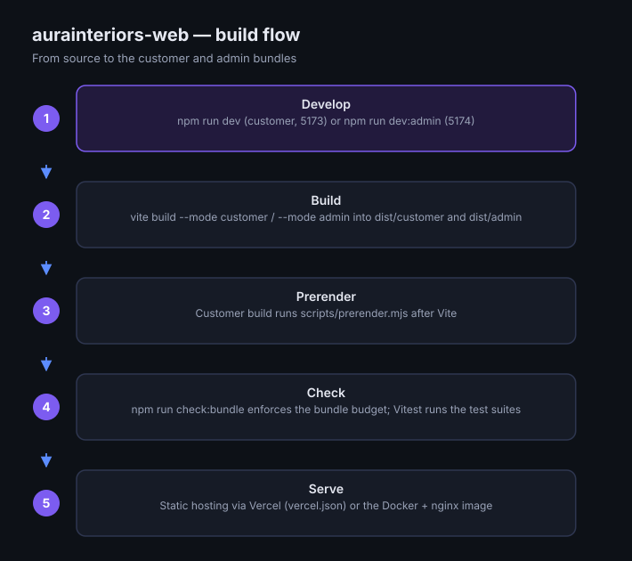

# Architecture



## System overview

```
Customer ──► Cloudflare ──► Render (nginx, storefront build)     www.aurainteriors.live
Admin    ──► Cloudflare ──► Vercel (admin build)                 admin.aurainteriors.live
Both apps ──► Cloudflare ──► Render (Node API + Socket.IO)       api.aurainteriors.live
API ──► MongoDB Atlas (data) · Cloudinary (images) · Brevo (email)
API ──► eSewa (payments) · Qdrant (chat knowledge vectors) · AI providers (Groq/Mistral/OpenRouter)
```

Cloudflare is DNS, TLS and proxy for every host. The storefront is a static
build served by nginx inside a Docker container on Render; the admin is a
static build on Vercel; the API is a long-lived Node process on Render.

## Rendering model (storefront)

The storefront is a React SPA with one twist: **catalog pages are prerendered
at build time**. `npm run build` runs Vite, then `scripts/prerender.mjs`
renders the home page, category/room/collection listings and every product
page to static HTML with correct titles, canonicals and Open Graph tags.
nginx serves those files directly; any route without a prerendered file
(`/checkout`, `/profile`, `/ar/*`…) falls back to the SPA shell
(`try_files` in `nginx.conf`).

The prerendered HTML is a SEO snapshot, not hydration — React mounts fresh
on top (`createRoot`), so the snapshot must never be the only place content
exists. A branded splash screen covers the brief mount interval.

The admin is a pure SPA: Vercel's `vercel.json` uses legacy `routes` (assets
caching, security headers, filesystem, then a catch-all to `index.html`) so
deep links like `/dashboard/reviews` work on refresh.

## Data flow

- **Reads/writes:** the web apps call the API with axios (`src/api/`), with
  TanStack Query for caching/refetching and Zustand for client state.
- **Settings:** on boot the storefront fetches `/api/v1/settings/public`
  (cached `Cache-Control: public, max-age=60, stale-while-revalidate=300`
  for anonymous catalog GETs) and `siteSettingsStore` applies identity,
  theme tokens (CSS variables on `<html>`), homepage section order and
  commerce rules. Changing settings in admin therefore re-skins the live
  store without a redeploy.
- **Real-time:** Socket.IO (with the MongoDB adapter, so it can scale across
  processes) carries chat messages, support presence and notifications.
  Push tokens for devices are stored server-side (`devicePushToken`).
- **Background jobs:** an in-process job system (`models/job.model.js`,
  `services/broadcastJobs.service.js`, `worker.js`) handles the email outbox
  (transactional mail is queued, never sent inline), chat knowledge-base
  ingestion (chunk → embed → Qdrant), scheduled promotion broadcasts and
  data-retention sweeps. Jobs use leases (`schedulerLease`) so only one
  worker runs a given job.

## API design

- Versioned REST under `/api/v1`, one route file + controller + service +
  Joi validator per resource (see [Project Structure](../getting-started/project-structure.md)).
- Middleware stack (in `app.js`): helmet, CORS restricted to the storefront
  and admin origins, a CSRF origin check on mutations, compression, cookie
  parser, 100kb JSON limit, NoSQL-injection sanitising, request logging,
  Passport initialisation.
- **Auth:** JWT in an httpOnly cookie (see
  [Accounts & Authentication](../features/accounts-and-auth.md)); `protect`
  requires a session, `protectOptional` personalises anonymous reads,
  `restrictTo('admin')` gates admin routes. Revoked tokens and login
  attempts are tracked (`revokedToken`, `authAttempt`) for security.
- **Rate limiting:** global plus per-route read/write limiters
  (`middleware/rateLimit.middleware.js`), backed by `rateLimitCounter`.
- **Errors:** a single `AppError` type and global handler produce a
  consistent `{ status, message }` shape.

## Payments flow (summary)

Checkout creates an order; for eSewa the customer is redirected to eSewa,
and on return the API **verifies the signature and captures the payment
server-side** (`services/esewaVerification.service.js`,
`services/esewaCapture.service.js`, `paymentCapture` records) before the
order is marked paid. Cash on Delivery orders skip payment entirely.
Full detail: [Payments](../features/payments.md).

## Scaling notes

- The API is stateless apart from MongoDB and Socket.IO's Mongo adapter —
  it can run multiple instances behind the same host.
- The storefront is static files behind Cloudflare; it scales trivially.
  Note the known quirk in [Operations](../deployment/operations-and-troubleshooting.md)
  about edge caching of static assets.
- Render's free tier sleeps when idle; the API exposes
  `/api/v1/system/keep-alive-status` and the settings include keep-alive
  options for the demo period. A paid instance removes cold starts.
