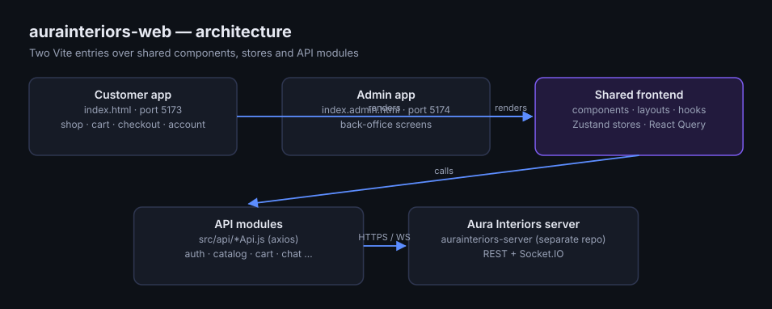

# Introduction

Aura Interiors is a furniture e-commerce platform built for Nepal: customers browse
sofas, beds, dining sets, wardrobes, lighting and décor; pay by Cash on Delivery or
eSewa; track their orders; get help from an AI support chat; and preview furniture
in their own room with augmented reality. The owner runs everything — products,
prices, orders, discounts, the store's name, logo, colours and even its third-party
service keys — from an admin panel, without a developer.

## The three parts

| Part | Repo | Stack | What it does |
| --- | --- | --- | --- |
| **Storefront + Admin** (`aurainteriors-web`) | this repo | React 19, Vite, Tailwind CSS v4, React Router, Zustand, TanStack Query | Two separately built apps from one codebase: the customer storefront (`--mode customer`) and the admin panel (`--mode admin`) |
| **API** (`aurainteriors-server`) | sibling repo | Node.js 20, Express, MongoDB + Mongoose, Socket.IO | REST API under `/api/v1`, authentication, payments, email, background jobs, real-time chat and notifications |
| **Data & services** | — | MongoDB Atlas, Cloudinary, Brevo, eSewa, Qdrant, Cloudflare | Database, image hosting, transactional email, payments, AI-chat vector search, DNS/CDN/SSL |

## What the platform includes

- **Catalog** — categories with a two-level hierarchy, product types, attribute
  definitions (materials, colours, dimensions…), rooms and collections, variants,
  stock tracking, and a seeded demo catalogue of 280 products.
- **Commerce** — guest and signed-in carts, discount codes and promotions,
  checkout with address book, order tracking, cancellations and returns.
- **Payments** — Cash on Delivery and eSewa (with server-side verification and
  capture). Khalti fields exist in settings but are not wired into checkout yet.
- **Accounts** — passwordless for customers: Google OAuth and magic links
  (accounts are created on first sign-in). Admins sign in with a password
  plus a one-time code. Sessions are JWTs in httpOnly cookies.
- **Admin panel** — dashboard analytics, catalog management, orders, reviews
  moderation, support inbox, media library, user management, audit log, a setup
  wizard, and a one-click **handover** flow for transferring the store.
- **Settings-driven store** — name, logo, theme colours, homepage sections,
  commerce rules (delivery threshold, currency), SEO, chat behaviour and
  integrations are stored in the database and editable in the admin panel.
  Third-party API keys are stored encrypted in a server-side vault.
- **AI support chat** — a customer-facing chat widget answered by an AI chain
  (Groq → Mistral → OpenRouter) grounded on a knowledge base of store documents
  embedded in Qdrant; human agents take over in the admin support inbox.
  Conversations are real-time over Socket.IO.
- **AR preview** — "View in your room" on product pages, powered by the
  `reticlexr` Capacitor package (ARCore on Android, ARKit on iOS) plus an
  iOS Safari Quick Look path using USDZ models.
- **SEO** — catalog pages are prerendered to static HTML at build time, with a
  generated sitemap, canonical URLs, Open Graph tags, a Google Merchant feed
  (`/api/v1/feeds/google.xml`) and an `llms.txt` for AI answer engines.

## Design principles worth knowing

1. **The store is data, not code.** Branding, homepage layout and business rules
   come from the settings API at runtime, so the same build can be rebranded and
   resold. See [Store Settings & Integrations](../features/store-settings-and-integrations.md).
2. **Two apps, one codebase.** Storefront and admin share components but build
   and deploy separately, so the public site never ships admin code.
3. **The API is the security boundary.** All authorisation, validation and rate
   limiting happen server-side; the web apps are untrusted clients.
4. **Free-tier friendly.** The whole platform runs on free tiers (Render free,
   Vercel, Cloudflare free, MongoDB Atlas free) until revenue justifies upgrades.

## Where to go next

- Run it locally: [Quick Start](quick-start.md)
- Understand the design: [Architecture](../development/architecture.md)
- Run the business: [Owner Handbook](../owner/owner-handbook.md)
